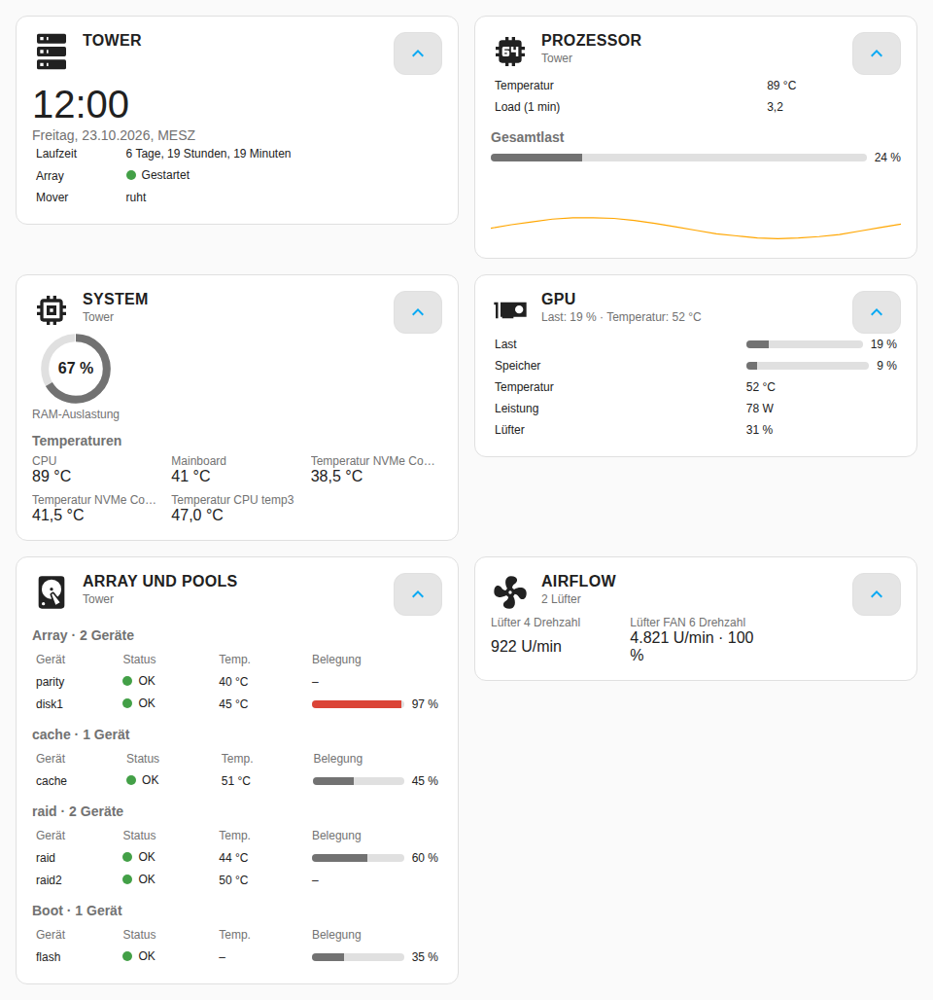
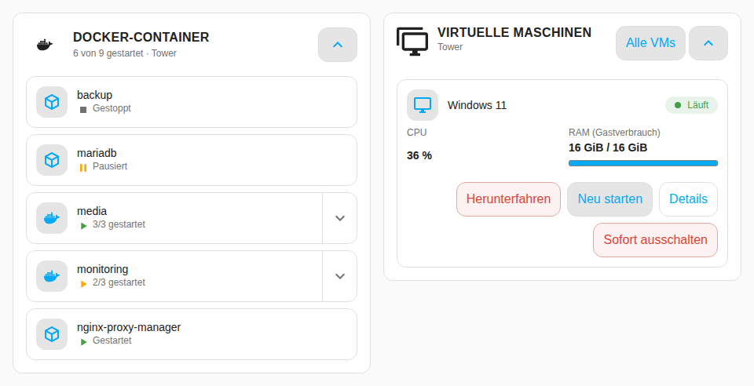
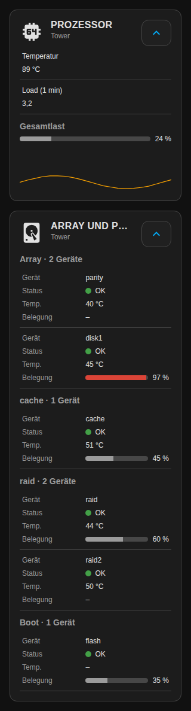

# Unraid Cards



Dashboard-Karten für Home Assistant, die das Unraid-Dashboard nachbauen: je
Unraid-Kachel eine Karte (Server, System, Prozessor, GPU, Array und Pools,
Parität, Airflow, Shares, Interfaces, Benutzer, USB-Geräte, Coral TPU, VMs, VM-Nutzung) sowie Steuerkarten für
Compose-Stacks, Container und die Docker-Übersicht. Die Daten kommen aus der
Integration [**Unraid SSH**](https://github.com/luukkii123/ha-unraid-ssh-integrations).

| Karte | Was sie zeigt |
| --- | --- |
| [`busch-unraid-server-card`](#busch-unraid-server-card) | Servername, Uhrzeit und Datum, Laufzeit, Array-Zustand, Mover |
| [`busch-unraid-system-card`](#busch-unraid-system-card) | RAM-Auslastung als Ring, Temperaturen (CPU, Mainboard, weitere Fühler) |
| [`busch-unraid-cpu-card`](#busch-unraid-cpu-card) | Gesamtlast, Load (1 min), CPU-Temperatur, Lastverlauf |
| [`busch-unraid-gpu-card`](#busch-unraid-gpu-card) | Last, Speicher, Temperatur, Leistung und Lüfter der Grafikkarte |
| [`busch-unraid-array-card`](#busch-unraid-array-card) | Platten von Array, Pools und Bootgerät mit Status, Temperatur, Belegung, Schlafzustand |
| [`busch-unraid-parity-card`](#busch-unraid-parity-card) | Paritätsprüfung: läuft/ruht, Fortschritt, Fehler |
| [`busch-unraid-airflow-card`](#busch-unraid-airflow-card) | Lüfter mit Drehzahl und Stufe |
| [`busch-unraid-shares-card`](#busch-unraid-shares-card) | Shares mit Speicher, Sicherheit, Export und offenen Pfaden |
| [`busch-unraid-interface-card`](#busch-unraid-interface-card) | Physische und virtuelle Interfaces mit Zustand und getrennten RX-/TX-Raten |
| [`busch-unraid-users-card`](#busch-unraid-users-card) | Benutzer, Kennwortwarnung und SMB-Shareberechtigungszahlen |
| [`busch-unraid-usb-card`](#busch-unraid-usb-card) | USB-Inventar mit belegten VM-/Remotezuordnungen und optionalem Hubfilter |
| [`busch-unraid-coral-card`](#busch-unraid-coral-card) | PCI-Coral mit Status und Temperatur sowie erkannte USB-Coral-Geräte |
| [`busch-unraid-vm-card`](#busch-unraid-vm-card) | Liste der VMs eines Servers oder eine einzelne VM, mit Aktionen |
| [`busch-unraid-vm-usage-card`](#busch-unraid-vm-usage-card) | CPU und RAM je laufender VM |
| [`busch-unraid-docker-card`](#busch-unraid-docker-card) | alle Docker-Container und Compose-Stacks eines Servers als Kacheln |
| [`busch-unraid-stack-card`](#busch-unraid-stack-card) | ein Compose-Stack mit Containersteuerung und Updates |
| [`busch-unraid-container-card`](#busch-unraid-container-card) | ein einzelner Container |

Jede Karte ist einzeln nutzbar und hat einen eigenen Editor.

## Voraussetzungen

- Home Assistant 2026.9.3 oder neuer.
- Die Integration **Unraid SSH** 0.8.0 oder neuer ist eingerichtet. Die Karten
  lesen nur deren Entitäten und lösen deren Aktionen aus; sie sprechen nie
  direkt mit dem Server. Ohne Server zeigt eine Karte „Kein Unraid-Server
  gefunden. Die Integration Unraid SSH einrichten.“
- Zusatzwerte und Serveraktionen benötigen **Unraid SSH 0.9 oder neuer**.
  Mit 0.8 bleiben bestehende Karten und Konfigurationen verwendbar; ein
  kurzer Hinweis zeigt fehlende Zusatzdaten an. Unbekannte Werte erscheinen
  als „–“, bekannte Nullwerte bleiben sichtbar.
- Benutzer-, USB- und Coral-Karte benötigen **Unraid SSH 0.10 oder neuer**.
  Fehlende Inventarsensoren zeigen einen konkreten Updatehinweis;
  Quellenausfälle und Teilbestände bleiben von erfolgreichen Leerbeständen getrennt.
- Die Prozessor-Karte zeichnet ihren Lastverlauf aus dem Verlauf von Home
  Assistant (Recorder). Ist die Last-Entität vom Recorder ausgenommen, zeigt
  sie „Noch kein Verlauf.“

## Installation

**Über HACS**

1. HACS → ⋮ → *Benutzerdefinierte Repositories* → Repository
   `https://github.com/luukkii123/ha-unraid-cards` hinzufügen, Kategorie
   **Dashboard**.
2. *Unraid Cards* herunterladen und den Browser hart neu laden (Strg+F5),
   sonst bleibt die alte Datei im Cache.

**Manuell**

1. `dist/unraid-cards.js` nach `config/www/unraid-cards.js` kopieren.
2. Unter Einstellungen → Dashboards → ⋮ → Ressourcen die Ressource
   `/local/unraid-cards.js` vom Typ *JavaScript-Modul* hinzufügen.
3. Browser hart neu laden.

Danach erscheinen die Karten in der Kartenauswahl. Alle Felder sind im Editor
mit Beschriftung und Erklärung (deutsch oder englisch, je nach HA-Sprache)
einstellbar, YAML ist optional.

**Umstieg von Busch Cards ≤ 0.21:** Unraid Cards installieren, Busch Cards
auf 0.22 aktualisieren, Seite neu laden — Dashboards bleiben unverändert.
Unraid Cards **vor oder zusammen mit** Busch Cards 0.22.0 installieren: Busch
Cards 0.22 enthält die Unraid-Karten nicht mehr, bis zur Installation zeigen
bestehende Unraid-Karten sonst „Custom element doesn't exist“. Die
Kartentypen `custom:busch-unraid-stack-card`, `-container-card`, `-vm-card`
und `-docker-card` heißen gleich, alte Konfigurationen gelten weiter. Solange
beide Bundles geladen sind, gewinnt das zuerst geladene, ohne Fehler. Bei der
VM-Karte werden die entfallenen Schlüssel `show_uptime`, `show_ip` und
`show_disk` still ignoriert.

## Gemeinsame Parameter der Kacheln

Gelten für Server-, System-, Prozessor-, GPU-, Array-, Paritäts-, Airflow-,
Shares-, Interface-, Benutzer-, USB-, Coral- und VM-Nutzungs-Karte.

| Schlüssel | Typ | Vorgabe | Bedeutung |
| --- | --- | --- | --- |
| `device_id` | Gerät | leer | Unraid-Server (Gerätemodell *Unraid*), dessen Daten die Karte zeigt. Leer: der einzige Server; gibt es mehrere, fordert die Karte zur Auswahl auf. |
| `title` | Text | leer | Überschrift der Karte. Leer: Name der Kachel (siehe unten). |

Fehlt ein einzelner Wert, entfällt die Zeile oder zeigt „–“; ist der Server
nicht erreichbar, bleibt der Kopf stehen und der Inhalt zeigt „Nicht
verfügbar“.

## busch-unraid-server-card

Vorgabetitel: der Servername (ersatzweise „Server“), darunter die
Unraid-Version. Zeigt Laufzeit, Array-Zustand, Mover, Servermodell und
Registrierungstyp. Bestätigte Aktionen: Neustarten, Ausschalten, Mover starten.

| Schlüssel | Typ | Vorgabe | Bedeutung |
| --- | --- | --- | --- |
| `show_clock` | Wahrheitswert | `true` | Zeigt Uhrzeit und Datum in der Zeitzone von Home Assistant |

```yaml
type: custom:busch-unraid-server-card
```

## busch-unraid-system-card

Vorgabetitel: „System“. RAM-Auslastung als Ring, Mainboard und BIOS sowie
die disjunkte RAM-Aufteilung in System, Cache, Puffer und frei. Verfügbarer
RAM ist eine zusätzliche Kennzahl. Boot, Log und Docker-Image haben eigene
Ringe und Kapazitäten; bei Docker im Verzeichnismodus gibt es keinen
Image-Ring. Temperaturen folgen darunter.

| Schlüssel | Typ | Vorgabe | Bedeutung |
| --- | --- | --- | --- |
| `show_temperatures` | Wahrheitswert | `true` | Listet CPU-, Mainboard- und weitere aktive Temperaturfühler |

```yaml
type: custom:busch-unraid-system-card
```

## busch-unraid-cpu-card

Vorgabetitel: „Prozessor“. Gesamtlast als Balken, Load (1 min),
CPU-Temperatur, CPU-Modell, Package-Leistung und die Gesamtlast als
Verlaufslinie. Der sichtbare Details-Knopf öffnet ein Raster der CPU-Kerne
mit ihren numerischen Linux-IDs. Der Verlauf wird nur
geladen, solange die Karte sichtbar ist, und höchstens einmal je Minute.

| Schlüssel | Typ | Vorgabe | Bedeutung |
| --- | --- | --- | --- |
| `history_minutes` | Auswahl `5` · `10` · `30` · `60` | `10` | Minuten, die die Verlaufslinie zeigt; andere Werte fallen auf 10 zurück |
| `show_history` | Wahrheitswert | `true` | Zeigt die Gesamtlast als Linie aus dem Verlauf von Home Assistant |

```yaml
type: custom:busch-unraid-cpu-card
history_minutes: "30"
```

## busch-unraid-gpu-card

Vorgabetitel: „GPU“. Last, Speicher, Temperatur, Leistung und Lüfter der
Grafikkarte, ergänzt um Modell und Treiberversion; ohne GPU „Keine GPU gefunden.“ Keine weiteren Parameter.

```yaml
type: custom:busch-unraid-gpu-card
```

## busch-unraid-array-card

Vorgabetitel: „Array und Pools“. Je Gruppe (Array, jeder Pool, Boot) ein
Untertitel mit gemessener Belegung und Kapazität (z. B. „Array · 768 GiB von
1,5 TiB“) und eine Tabelle Gerät · Status · Temp. · Belegung; schlafende
Platten sind als „schläft“ markiert. Auf schmalen Karten werden die
Tabellenzeilen gestapelt statt seitlich gescrollt. SMART-Textstatus,
Cachezeitpunkt und Warnungsdetails ergänzen die Platten; Poolzustand,
Dateisystem und explizite Mitglieder ergänzen die Gruppen. Die Aktionen
Array starten/stoppen und alle Platten schlafen legen sind immer bestätigt.

Die Kapazitäten benötigen die Sensoren `disk_used` und `disk_total` aus
Unraid SSH ab 0.8.1. Das Array summiert ausschließlich Datenlaufwerke, keine
Paritätsplatten. Je Pool wird das logische Dateisystem einmal gezählt;
weitere Poolmitglieder erhöhen die Kapazität nicht. Boot bleibt separat.
Fehlende, nicht verfügbare oder unvollständige Messwerte erscheinen als „–“;
aus Prozentwerten werden keine Größen geschätzt. Die Anzeige berücksichtigt
die in Home Assistant gewählte Einheit und formatiert binär (KiB bis PiB).

| Schlüssel | Typ | Vorgabe | Bedeutung |
| --- | --- | --- | --- |
| `show_boot` | Wahrheitswert | `true` | Zeigt den USB-Stick bzw. das Bootgerät als eigene Gruppe |

```yaml
type: custom:busch-unraid-array-card
show_boot: false
```

## busch-unraid-parity-card

Vorgabetitel: „Parität“. Zeigt „Prüfung läuft“ oder „Keine Prüfung aktiv“,
„Prüfung pausiert“ oder eine andere Sync-Aktion, den Fortschritt und die
Fehlerzahl; ohne Paritätsplatte „Keine Paritätsplatte
vorhanden.“ Starten prüft ausschließlich ohne Korrektur; Pausieren,
Fortsetzen und Abbrechen verlangen ebenfalls eine Bestätigung. Keine weiteren Parameter.

```yaml
type: custom:busch-unraid-parity-card
```

## busch-unraid-airflow-card

Vorgabetitel: „Airflow“. Lüfter-Raster mit Name, U/min und – bei PWM-Steuerung –
Stufe in Prozent; die Lüfteranzahl steht im Untertitel.

| Schlüssel | Typ | Vorgabe | Bedeutung |
| --- | --- | --- | --- |
| `hide_idle` | Wahrheitswert | `false` | Blendet Lüfter mit 0 U/min aus (nicht verfügbare bleiben sichtbar) |

```yaml
type: custom:busch-unraid-airflow-card
hide_idle: true
```

## busch-unraid-shares-card

Vorgabetitel: „Shares“. Tabelle Name · Belegt · Frei, sortiert nach Name; die
Anzahl steht im Untertitel. Mit aktuellen Zusatzdaten kommen Sicherheit,
Exportstatus und Streams hinzu. Streams zählen offene eindeutige Pfade
wie im Unraid-Dashboard; sie sind keine Anzahl von SMB-Sitzungen.
Keine weiteren Parameter.

```yaml
type: custom:busch-unraid-shares-card
```

## busch-unraid-vm-usage-card

Vorgabetitel: „VM-Nutzung“. Je laufender VM ein Balken für die Gast-CPU und
der RAM; die Gast-CPU bleibt 100 % je vollständig belegtem Hostkern und
kann deshalb über 100 % liegen. Daneben stehen der gesonderte Host-CPU-Anteil,
Netz empfangen/senden und Datenträger lesen/schreiben. Ohne laufende VM
„Keine laufenden VMs.“ Keine weiteren Parameter.

```yaml
type: custom:busch-unraid-vm-usage-card
```

## busch-unraid-interface-card

Vorgabetitel: „Interfaces“. Jedes Interface steht für sich: Name, Zustand,
Typ, Empfang, Senden, Linkgeschwindigkeit und MTU. Empfang und Senden sind
Byte pro Sekunde, keine Bitrate. Überlappende physische, Bond-, Bridge- und
VLAN-Links werden nicht addiert. Namen sind natürlich sortiert.

| Schlüssel | Typ | Vorgabe | Bedeutung |
| --- | --- | --- | --- |
| `show_virtual` | Wahrheitswert | `true` | Zeigt virtuelle Interfaces; ausgeschaltet bleiben nur physische Links |

```yaml
type: custom:busch-unraid-interface-card
show_virtual: true
```

Serveraktionen sind unabhängig von alten Container-/VM-Bestätigungsoptionen
immer bestätigt. Der Dialog nennt den Zielserver und die Auswirkung. Die
Integration prüft den aktuellen Zustand vor dem Ausführen. Nach Annahme
lautet das Feedback „Anfrage gesendet; Verbindung/Serverzustand prüfen“;
Verbindungsabbruch oder Timeout gilt nicht als bestätigter Erfolg und löst
keine automatische Wiederholung aus.

## busch-unraid-users-card

Vorgabetitel: „Benutzer“. Zeigt Benutzeranzahl, Anzahl ohne gesetztes Kennwort
und Benutzer · Beschreibung · Schreiben · Lesen. Die Kennwortwarnung ist
zusätzlich als Text sichtbar. Schreiben/Lesen zählt SMB-Shares mit der jeweiligen
Berechtigung; diese Werte sind keine I/O-Zähler oder Sitzungszahlen. Root und
Benutzer bei deaktiviertem SMB zeigen „–“ für unbekannte Berechtigungszahlen.
Die Quelle berücksichtigt bekannte exportierte User-, Disk- und Flash-Shares;
unsichere oder unvollständige Quellen werden sichtbar bezeichnet. Benutzernamen
und Beschreibungen sind für berechtigte Home-Assistant-Nutzer lesbar.
Keine weiteren Parameter und keine Benutzer- oder Kennwortaktionen.

```yaml
type: custom:busch-unraid-users-card
```

## busch-unraid-usb-card

Vorgabetitel: „USB-Geräte“. Tabelle Port · Name · Zustand · VM/Remote, optional
mit Linkgeschwindigkeit. „Am Host erkannt“ behauptet keine freie Verfügbarkeit.
VM- und Remoteziele erscheinen nur für belegte aktuelle Verbindungen;
fehlendes Mapping bleibt unbekannt. USB-Manager ist optional. Geräte hinter
vollständig per VFIO durchgereichten USB-Controllern sind am Host unsichtbar;
das Inventar kann sie daher nicht vollständig erfassen. Keine USB-Steuerung.

| Schlüssel | Typ | Vorgabe | Bedeutung |
| --- | --- | --- | --- |
| `show_hubs` | Wahrheitswert | `true` | Zeigt USB-Hubs zusätzlich zu den übrigen erkannten Geräten |

```yaml
type: custom:busch-unraid-usb-card
show_hubs: false
```

## busch-unraid-coral-card

Vorgabetitel: „Coral TPU“. Tabelle Gerät · Zustand · Temperatur für PCI-Coral;
nur bekannter Kernelstatus führt zu „Bereit“. Fehlende Temperaturen erscheinen
als „Nicht verfügbar“. USB-Coral erscheint mit „USB erkannt, Status/Temperatur
nicht verfügbar“: Anwesenheit belegt weder Betriebsbereitschaft noch Inferenz.
Ohne Geräte erscheint „Keine Coral TPU gefunden“, bei Quellenfehlern ein
Fehlerhinweis. Keine weiteren Parameter, kein Reset oder Treiberwechsel.

```yaml
type: custom:busch-unraid-coral-card
```

## busch-unraid-vm-card

Zwei Ansichten, je nach `device_id`:

- **Server** (Gerätemodell *Unraid*) oder leer → Liste aller VMs des Servers
  mit Symbol, Name und Zustand. Der Knopf *Alle VMs* blendet gestoppte VMs ein
  oder aus; das ändert nur die Anzeige, nicht die gespeicherte Konfiguration.
- **Einzelne VM** (Gerätemodell *Virtual machine*, so wie in Busch Cards
  ≤ 0.21 konfiguriert) → die bisherige Einzelansicht mit CPU und RAM.

Aktionen je VM: Starten, Herunterfahren (fordert den Gast zum geordneten
Ausschalten auf), Neu starten und Sofort ausschalten (fragt immer mit
Datenverlustwarnung nach). Es erscheinen nur Aktionen, die die Integration
für die VM anbietet.

| Schlüssel | Typ | Vorgabe | Bedeutung |
| --- | --- | --- | --- |
| `device_id` | Gerät | leer | Unraid-Server für die VM-Liste oder eine einzelne VM. Leer: der einzige Server. |
| `title` | Text | leer | Eigener Titel; leer verwendet den VM-Namen bzw. „Virtuelle Maschinen“ |
| `show_all` | Wahrheitswert | `false` | Zeigt auch gestoppte VMs |
| `layout` | `compact` \| `detailed` | `detailed` | Kompakt oder ausführlich |
| `show_status` | Wahrheitswert | `true` | Zeigt den belegten Betriebszustand |
| `show_controls` | Wahrheitswert | `true` | Zeigt unterstützte Aktionen |
| `show_restart` | Wahrheitswert | `true` | Neustart anzeigen; nur mit nativem Neustart-Button der Integration verfügbar |
| `confirm_stop` | Wahrheitswert | `true` | Fragt vor dem Stoppen nach |
| `confirm_restart` | Wahrheitswert | `true` | Fragt vor dem Neustart nach |
| `show_cpu` | Wahrheitswert | `true` | Zeigt CPU in Prozent je Kern; über 100 % ist möglich, fehlende Werte sind nicht verfügbar |
| `show_ram` | Wahrheitswert | `true` | Zeigt Gastverbrauch, sonst ausdrücklich zugewiesenen RAM (Host-RSS ist kein Gastverbrauch) |
| `display_mode` | `auto` \| `image` \| `icon` | `auto` | Automatisch bevorzugt verfügbare Bilder; *Bild* bevorzugt das eigene Bild, *Icon* zeigt nur das Icon |
| `image` | Text | leer | Optionale Bild-URL; leer verwendet vorhandenes Bild oder Icon |
| `icon` | Icon | leer | Optionales `mdi:`-Icon für Anzeige und Bildfehler; leer verwendet das VM-Icon |
| `debug` | Wahrheitswert | `false` | Zeigt zugeordnete IDs zur lokalen Diagnose |

```yaml
type: custom:busch-unraid-vm-card
show_all: true
```

## busch-unraid-docker-card



Docker-Übersicht eines Unraid-Servers, angelehnt an das Docker-Widget des
Unraid-Dashboards: je Compose-Stack eine Kachel, je eigenständigen Container
eine Kachel, mit Containerbild (ersatzweise Symbol), Name und Zustand
(„4/4 gestartet“, „Gestoppt · 0/2“, *Gestartet*, *Gestoppt*, *Pausiert*,
*Nicht verfügbar*, *Update läuft*). Vorgabetitel: „Docker-Container“.

- **Ausklappen:** der Pfeil an einer Stack-Kachel blendet dessen Container
  direkt dahinter ein. **Umschalt + Plus** klappt alle Stacks auf,
  **Umschalt + Minus** alle zu.
- **Aktionen:** ein Klick oder Tipp auf eine Kachel öffnet ihr Menü (am Handy
  als Blatt am unteren Rand): Aus-/Einklappen, Starten, Stoppen, Neu starten,
  Update bzw. *Alle aktualisieren* (nur wenn ein Update vorliegt) und Details.
  Escape, Zurück, das Kreuz oder ein Klick daneben schließen das Menü.
- Die Spaltenzahl passt sich an die Kartenbreite an (eine Spalte am Handy,
  bis zu vier auf breiten Karten).

| Schlüssel | Typ | Vorgabe | Bedeutung |
| --- | --- | --- | --- |
| `device_id` | Auswahl | der einzige Server | Unraid-Server, dessen Container gezeigt werden |
| `title` | Text | „Docker-Container“ | Eigener Kartentitel |
| `hide_stopped` | Wahrheitswert | `false` | Blendet gestoppte Stacks und Container aus |
| `sort` | `name` \| `state` | `name` | Sortiert die Kacheln nach Name oder Zustand |
| `start_expanded` | Wahrheitswert | `false` | Zeigt die Container jedes Stacks schon beim Laden |
| `columns` | `auto` \| `1` … `4` | `auto` | Legt die Spaltenzahl fest; automatisch passt sie an die Kartenbreite an |
| `confirm_stop` | Wahrheitswert | `true` | Fragt vor dem Stoppen nach |
| `confirm_restart` | Wahrheitswert | `true` | Fragt vor dem Neustart nach |

```yaml
type: custom:busch-unraid-docker-card
hide_stopped: true
```

Pausieren, Bearbeiten und Entfernen von Containern bietet die Karte nicht an:
die Integration stellt dafür keine Aktionen bereit.

## Stack- und Container-Karte

Beide werden über `device_id` an ein Gerät der Integration gebunden (Modell
*Compose stack* bzw. *Docker container*). Ist die Zuordnung nicht eindeutig,
bleiben die Steuerungen aus Sicherheitsgründen gesperrt. Ein
Update-Fortschritt erscheint nur, wenn die Integration echte Werte liefert.

Gemeinsame Schlüssel (S = Stack, C = Container):

| Schlüssel | Typ | Vorgabe | S | C | Bedeutung |
| --- | --- | --- | :-: | :-: | --- |
| `title` | Text | Gerätename | ja | ja | Eigener Kartentitel |
| `device_id` | Auswahl | erstes passendes Gerät | ja | ja | Unraid-Gerät; im Kartenvorschlag ist das erste passende vorbelegt |
| `switch_entity` | Entität | automatisch | ja | ja | Ordnet bei älterem Backend einen Schalter ausdrücklich zu |
| `layout` | `compact` \| `detailed` | `detailed` | ja | ja | Bestimmt den Umfang der Angaben |
| `show_status` | Wahrheitswert | `true` | ja | ja | Zeigt Zustand und laufende Container |
| `show_controls` | Wahrheitswert | `true` | ja | ja | Zeigt verfügbare Start- und Stoppaktionen |
| `show_updates` | Wahrheitswert | `true` | ja | ja | Zeigt zugeordnete verfügbare Updates |
| `show_restart` | Wahrheitswert | `true` | ja | ja | Zeigt ausschließlich native Neustartaktionen; ohne Unterstützung der Integration nicht verfügbar |
| `confirm_stop` | Wahrheitswert | `true` | ja | ja | Fragt vor dem Stoppen nach |
| `confirm_restart` | Wahrheitswert | `true` | ja | ja | Fragt vor dem Neustart nach |
| `display_mode` | `auto` \| `image` \| `icon` | `auto` | ja | ja | Automatisch bevorzugt vorhandene Bilder, dann eigenes Bild und Icon |
| `image` | Text | leer | ja | ja | Optionale Bild-URL, kein Docker-Image-Tag |
| `icon` | Icon | leer | ja | ja | Optionales `mdi:`-Icon; Ersatz bei fehlendem oder fehlerhaftem Bild |
| `show_cpu` | Wahrheitswert | `true` | ja | ja | Zeigt die CPU, wenn sie zuverlässig zugeordnet ist; fehlende Daten werden nicht erfunden |
| `show_ram` | Wahrheitswert | `true` | ja | ja | Zeigt den RAM, wenn er zuverlässig zugeordnet ist |
| `debug` | Wahrheitswert | `false` | ja | ja | Zeigt die zugeordneten Entity-IDs zur lokalen Diagnose |

### busch-unraid-stack-card

Compose-Stack mit laufenden Containern, Stacksteuerung und zugeordneten
Updates.

| Schlüssel | Typ | Vorgabe | Bedeutung |
| --- | --- | --- | --- |
| `show_containers` | Wahrheitswert | `true` | Zeigt die Containerliste des Stacks |
| `state_filter` | `all` \| `running` \| `stopped` | `all` | Zeigt alle, laufende oder gestoppte Container |
| `sort` | `name` \| `state` | `name` | Sortiert Container nach Name oder Zustand |
| `start_expanded` | Wahrheitswert | `true` | Öffnet die Containerliste beim Laden |

```yaml
type: custom:busch-unraid-stack-card
device_id: YOUR_STACK_DEVICE_ID
```

### busch-unraid-container-card

Einzelner eigenständiger oder Compose-Container.

| Schlüssel | Typ | Vorgabe | Bedeutung |
| --- | --- | --- | --- |
| `container_key` | Auswahl | der einzige Container | Wählt einen Container anhand seiner Backendkennung, wenn das Gerät mehrere hat |
| `update_entity` | Entität | automatisch | Ordnet bei älterem Backend das passende Update ausdrücklich zu |

```yaml
type: custom:busch-unraid-container-card
device_id: YOUR_DEVICE_ID
container_key: YOUR_CONTAINER_KEY
```

## Bedienung und Darstellung



- **Einklappen:** Der Pfeil im Kopf der Kacheln, der VM-Liste und der
  Docker-Karte klappt die Karte bis auf den Kopf ein. Der Zustand wird je Karte im Browser
  gemerkt (je Kartentyp, Server und Titel) und gilt nur für dieses Gerät.
- **Bestätigungsdialog:** Stoppen, Herunterfahren, Neu starten und Sofort
  ausschalten fragen vorher nach (Sofort ausschalten immer). Der Dialog nennt
  das betroffene Objekt, z. B. „„Nextcloud“ stoppen?“. Er schließt mit
  Escape, Browser-Zurück oder *Abbrechen*; ein Klick daneben schließt ihn
  bewusst nicht, damit nichts versehentlich ausgelöst oder verworfen wird.
  Während eine Aktion läuft, ist der Knopf gesperrt; ein Fehler wird mit dem
  nächsten Schritt angezeigt.
- **Zustände:** Solange Home Assistant die Register noch lädt, zeigen die
  Karten „Wird geladen …“ statt eines Leerzustands. Sind die Hauptsensoren
  eines Servers nicht verfügbar, bleibt der Kopf stehen und der Inhalt zeigt
  „Nicht verfügbar“; ein unbekannter Paritäts- oder VM-Zustand wird als
  solcher angezeigt, nicht als „ruht“ bzw. „Keine laufenden VMs“.
- **Tastatur:** Alle Knöpfe sind per Tab erreichbar und haben einen sichtbaren
  Fokus.
- Status wird nie nur über Farbe gezeigt, immer auch als Text. Die Karten
  passen sich schmalen Breiten an (ab 320 px, Sections-Layout).

## Theme-Variablen

Es gibt keine eigenen Variablen. Die Karten übernehmen die Standardvariablen
von Home Assistant: `--primary-text-color`, `--secondary-text-color`,
`--primary-color`, `--card-background-color`,
`--secondary-background-color`, `--divider-color`, `--error-color`,
`--warning-color`, `--success-color`, `--ha-card-border-radius` sowie die
`--ha-space-*`- und `--ha-font-*`-Größen. Das gewählte Theme gilt also auch
hier, hell wie dunkel.

## Entwicklung

`dist/unraid-cards.js` ist Quelltext und Auslieferung zugleich (reines
Vanilla-JS, kein Build). Hinweise zu Aufbau, Tests und Renderprüfung:
[docs/entwicklung.md](docs/entwicklung.md).

## Lizenz

MIT, siehe [LICENSE](LICENSE).
